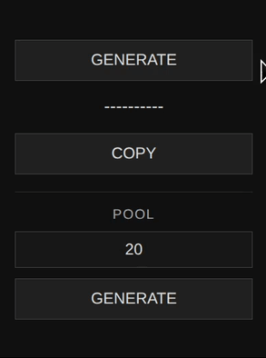

[](https://discord.gg/ENB7RbxVZE)&nbsp;[](https://github.com/AndrewShedov/class-generator/blob/main/LICENSE)

# Class Generator

Minimalist desktop tool for generating CSS class names and HTML IDs. Built with [Electron.js](https://www.electronjs.org/).

### ✨ Features

- **One-click generation** — generate a single identifier or an entire pool in one click (or press <code>Enter</code> inside the pool input).
- **Pool mode (<code>POOL</code>)** — generate from <code>1</code> to <code>3,000</code> unique, space-separated identifiers at once (default: <code>20</code>).
- **Auto-copy with visual feedback** — generated names (single or pool) are automatically copied to the clipboard, and the clicked button flashes <code>COPIED</code>. You can also click <code>COPY</code> to re-copy the current single identifier.
- **Cryptographically secure & valid identifiers** — powered by <code>crypto.getRandomValues()</code> with rejection sampling (no modulo bias) and guaranteed uniqueness within each generated pool. Every identifier starts with a Latin letter (<code>a–z</code>, <code>A–Z</code>) followed by alphanumeric characters (<code>a–z</code>, <code>A–Z</code>, <code>0–9</code>), making it valid for CSS classes, HTML <code>id</code> attributes, and JS/HTMX selectors.
- **High collision resistance** — with a 10-character length (<code>hT5rIQCYq8</code>) and a pool of 62 characters (52 letters for the first character), there are **approximately 700 quadrillion (7×10¹⁷) possible combinations**. Even generating one class every second, **it would take over 30 years to reach just a 50% chance of a single collision**. The probability of a duplicate in a real-world project is practically zero.
- **Portable** — no installation required on Windows. Сlean <code>.deb</code> package on Debian/Ubuntu.

<p align="center">

</p>

### 🚀 Installation

Download the latest version for your OS from the [Releases page](https://github.com/AndrewShedov/class-generator/releases):

- 🪟 [Class Generator.exe](https://github.com/AndrewShedov/class-generator/releases/download/v1.1.0/Class.Generator.exe) (Windows Portable — run directly, no installation required)
- 🐧 [Class Generator.deb](https://github.com/AndrewShedov/class-generator/releases/download/v1.1.0/Class.Generator.deb) (Linux Debian/Ubuntu)

#### Linux (Debian / Ubuntu)

Install the downloaded <code>.deb</code> package via <code>apt</code> (from the folder containing the file):

```bash
sudo apt install ./Class.Generator.deb
```

*(If you built the package locally in <code>dist/</code>, the filename contains a space: <code>sudo apt install "./Class Generator.deb"</code>).*

After installation, **Class Generator** will appear in your Applications menu and can also be launched from a terminal via <code>class-generator</code>.

Optional — copy the shortcut to your Desktop:

```bash
cp /usr/share/applications/class-generator.desktop ~/Desktop/
chmod +x ~/Desktop/class-generator.desktop
```

To uninstall at any time:

```bash
sudo apt remove class-generator
```

### 🛠️ Customization

If you want to tailor the tool to your specific needs, you can easily modify the source code:

- **Adjust Generation Logic:** In <code>[js/renderer.js](https://github.com/AndrewShedov/class-generator/blob/main/js/renderer.js)</code>, update <code>const CLASS_LENGTH</code> to change the identifier length, or modify <code>FIRST_CHARS</code> / <code>ALL_CHARS</code> to change the character pool (<code>FIRST_LIMIT</code> and <code>ALL_LIMIT</code> adjust automatically).
- **Change Default & Max Pool Size:** The default pool count is <code>20</code> and the allowed range is <code>1–3000</code>. To change the default value, edit <code>value="20"</code> on <code>#pool-count</code> in <code>[index.html](https://github.com/AndrewShedov/class-generator/blob/main/index.html)</code>. To change the maximum limit, update both <code>const MAX_POOL_SIZE = 3000</code> in <code>[js/renderer.js](https://github.com/AndrewShedov/class-generator/blob/main/js/renderer.js)</code> and <code>max="3000"</code> in <code>[index.html](https://github.com/AndrewShedov/class-generator/blob/main/index.html)</code>.
- **Toggle "Always on Top":** In <code>[main.js](https://github.com/AndrewShedov/class-generator/blob/main/main.js)</code>, change <code>alwaysOnTop: false</code> to <code>true</code> if you want the window to stay above other applications.

#### How to apply changes:

1. Download the [source code](https://github.com/AndrewShedov/class-generator/archive/refs/tags/v1.1.0.zip).

2. Open the project folder in your terminal.

3. Install dependencies:

```bash
npm install
```

4. Build the application for your OS:

Windows *(on Windows, or on Linux with Wine installed)*:

```bash
npm run build:win
```

Linux (Debian / Ubuntu):

```bash
npm run build:linux
```

After the build finishes, your output file will be waiting in the <code>dist</code> folder:
- Windows: <code>dist/Class Generator.exe</code> (portable — run directly).
- Linux: <code>dist/Class Generator.deb</code> (install with <code>sudo apt install "./Class Generator.deb"</code>).

Once installed (or once you've saved the <code>.exe</code> / <code>.deb</code>), all remaining source and build files can be deleted.
<br>

[](https://shedov.top/) 
[](https://crystal.you/AndrewShedov)
[](https://discord.gg/ENB7RbxVZE)
[](https://t.me/ShedovTop)
[](https://x.com/AndrewShedov)
[](https://www.youtube.com/@AndrewShedov)
[](https://vk.com/ShedovTop)
[](https://vkvideo.ru/@ShedovTop)